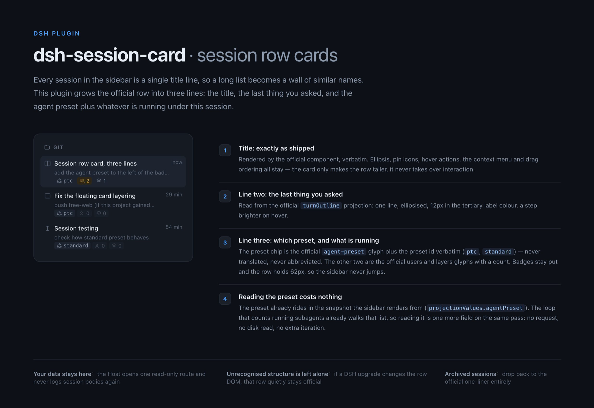

# dsh-session-card

[中文](./README.zh.md) | English

[](https://www.npmjs.com/package/@yaorenliang/dsh-session-card) [](./LICENSE)

Every session in the sidebar gets two more lines under its title: **the question you last asked**, and **which agent preset the session runs** together with the subagents and background tasks it has running.

The official session row is one line — a title, a time, an icon — so once the list grows long, every row reads like every other row. This plugin adds a summary of what you last asked, so the sidebar says which session is which on its own.

## Screenshots



The sidebar as it looks in the real UI; four annotations in the picture name each line and what it carries.

## What you get

- **Line 1** — the official title, kept verbatim: truncation, hover actions, the pin icon and the context menu all still work.
- **Line 2** — your most recent question, one line, ellipsised, 12px in the tertiary label colour; a step brighter on hover.
- **Line 3** — the badges, three of them, left to right:
  - **Preset** — the official agent-preset glyph (the three-node graph) plus the preset id as written, `ptc` or `standard`. The id is neither translated nor abbreviated: DSH itself uses that id wherever a stable name is needed, and an invented abbreviation would only break the day a fifth preset appears. The tooltip reads "Agent preset ptc".
  - **Subagents / background tasks** — the official users and layers glyphs plus a count, no words: a sentence like "0 subagents" does not fit a sidebar row about 200px wide. The tooltip carries the full sentence ("0 subagents running"). Only a running subagent keeps a fill (the platform's amber), because that is the one thing on the line worth catching the eye; the job count is a fact about the session, not an activity, so it is set as plain dimmed text. While nothing runs, both badges **stay where they are and drop to grey**, with a 0.

  The preset badge is the one that never falls idle — it has no count that can reach zero, so the "keep badges while idle" switch has nothing to say about it. A session that has not assembled an agent yet (blank) simply omits it.

By default (badges keep their place) the row height holds at 62px — a 20px title, a 16px question line and a 16px badge line, 2px between each, plus the card's own internal padding — so a session measures the same from idle to working to finished, and the sidebar never jumps. With "keep badges while idle" off, badges appear only while work runs: 45px with just the question line, and nothing to say falls **all the way back to the official 32px**. Height is derived from the content (`grid-template-rows: 20px auto auto`) rather than declared as a `min-height`, so no combination of lines can leave a stray empty track behind.

When a card appears, lines 2 and 3 open downward inside the cells they already occupy (about 220ms); under `prefers-reduced-motion` nothing animates.

## When it stays out of the way

- **Archived sessions** — drop back to the official presentation entirely; no card is drawn.
- **Unrecognised row structure** (a DSH upgrade changed the row DOM) — that row is skipped, the rest carry on.
- **Switched off in Settings** — everything falls back to the official row.

The switches live at the bottom of **Settings → General**: enable cards / show the question line / show running badges / keep badges while idle (on by default). State is kept in `localStorage` under `dsh-session-card:settings`.

## Where the data comes from

| Line | Source |
| --- | --- |
| Your most recent question | the `turnOutline` projection (the official projection of the turn log; the log is not parsed again) |
| Background task count | `jobs.list()`, counting only what this session owns and is running |
| Subagent count | computed in the browser from `parentId` + `running` in the session list |
| Agent preset | `projectionValues.agentPreset` from that same session list (the official `agentPreset` projection) |

**The preset costs nothing.** The sidebar already holds that snapshot while it renders (`title`, `tokenUsage` and `agentPreset` arrive together), and the pass that counts running subagents has already walked it, so reading the preset is one more field on the same pass — no request, no disk read, no extra loop.

The Host opens exactly one read-only route, `GET /api/dsh-session-card/rows?ids=…`, behind DSH's own authentication fence, with `cache-control: no-store`. Session bodies never leave the machine and no new log line is written.

The browser keeps the previous answer on this machine (`localStorage`, key `dsh-session-card:facts`, expiring after 7 days) so a reload can paint the card with the first frame and correct it in place once the network answer arrives — a refresh never shows the official one-line row first and then snaps into a card.

## Install

Every release carries the built package as an attached tarball. Download it from the [latest release](https://github.com/yaorenliang/dsh-session-card/releases/latest) and add that file — no clone, no build:

```sh
dsh plugin --profile <your profile> add ./yaorenliang-dsh-session-card-0.1.3.tgz
```

> **Don't install it by name yet.** `dsh plugin add @yaorenliang/dsh-session-card` resolves to whatever the registry holds, and the registry still holds 0.1.1 — the release before the cascade fix, which renders as a squeezed one-line row on DSH 0.2.3 and later. Publishing to the registry needs a one-time trusted-publisher setting on the package's npm page; the tarball above is the install path until that exists.

**Restart the DSH instance afterwards.** A profile's plugin table is read at boot and the Loader watches no files: hot reload rebuilds the client bundle but never mounts a newly added Host plugin.

## Requirements

- DeepSeek Harness `>=0.2.2-rc.1 <0.3.0`, Node `>=20`.

## Development

```sh
pnpm install
pnpm verify   # tsc --noEmit && vitest run && node scripts/build.mjs
```

Build products: `lib/index.js` (the Host half, ESM) and `lib/client.js` (the browser half, wrapped for `__ModuleLoader__`). `lib/types/` holds the declarations.

**Change styles in `src/client/card.css` and `settings.css`, then re-run `pnpm build`** — the two `*-stylesheet.ts` modules are generated; do not edit them by hand.

## Layout

```
src/
  core/       prompt summarising, subagent counting, preset reading (pure, unit-tested)
  host/       the one read-only route + the Host contract it needs
  client/     row painting, the settings row, polling and stylesheet installation
docs/
  showcase.html           the showcase page (open it in a browser; the screenshot renders from it)
  showcase.en.html        the same page in English
  screenshot-card.png     the picture in README.zh.md
  screenshot-card-en.png  the picture above
```

## Boundaries

The plugin adds two lines of in-row DOM and one stylesheet. It **never takes over** the official row's click, drag, context menu or hover actions, and never changes session data. If another plugin that also rewrites the session-row DOM is installed at the same time, the two may overwrite each other — switch one of them off.

## Documentation

- [Changelog](./CHANGELOG.md) · [中文](./CHANGELOG.zh.md)
- [Security policy](./SECURITY.md) · [中文](./SECURITY.zh.md)

## License

MIT © 姚壬亮