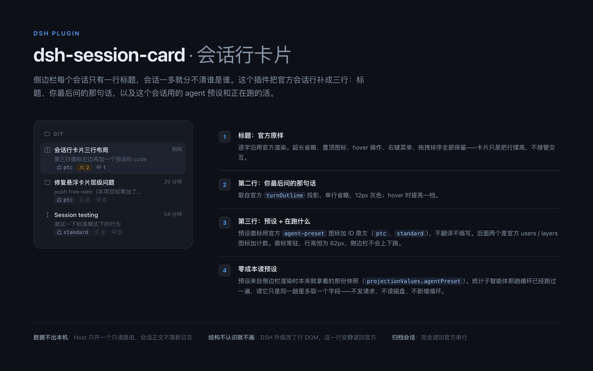

# dsh-session-card

中文 | [English](./README.md)

侧边栏里每个会话一行，标题下面再加两行：**你最后问的那句话**，以及**这个会话用的哪个 agent 预设**、正在跑的子智能体和后台任务。

DSH 官方的会话行只有一行（标题 + 时间 + 图标），会话多了以后分不清哪个是哪个。这个插件在你最近问过的问题上补一行摘要，让侧边栏自己说明它是谁。

## 截图



侧边栏在真实界面里的样子，图里四条注解说明每一行是什么。

## 长什么样

- **第 1 行**：官方标题，逐字沿用（超长省略、hover 操作、置顶图标、右键菜单全部保留）。
- **第 2 行**：你最近一次提问，单行省略，12px 灰色；hover 时提亮一档。
- **第 3 行**：徽标，从左到右三个。
  - **预设**：官方的 agent-preset 图标（三个节点的图）+ 预设 ID 原文，如 `ptc`、`standard`。ID 不做翻译也不做缩写——DSH 自己在需要稳定名字的地方就用这个 ID，自造缩写只会在出现第五种预设时失效。hover 是「智能体预设 ptc」。
  - **子智能体 / 后台任务**：官方那两个图标（users / layers）+ 计数，不写字——「子智能体 0」「后台任务 0」这种长文案在 200px 宽的侧边栏里放不下。hover 有完整一句话（「0 个子智能体运行中」）。子智能体徽标琥珀底，后台任务徽标卡片灰底；没有在跑的时候两个徽标**留在原地转灰**，计数写 0。

  预设徽标是**唯一常驻**的那个：它没有计数可以归零，所以不受「徽标常驻」开关管；会话还没有组装 agent（blank）时它不出现。

默认（徽标常驻）行高恒定 62px（标题 20 + 2 + 提问 16 + 2 + 徽标 16 + 上下各 3px 内填充）：一个会话从空闲、跑活到跑完，行高始终不变，侧边栏不会上下跳。关掉「徽标常驻」后徽标只在有活时才出现，只剩提问行时 45px；什么都没得说就**整行退回官方 32px**。行高由内容推导（`grid-template-rows: 20px auto auto`），不靠写死 `min-height`，所以不存在某个组合下多留一条空行的情况。

卡片出现时，第 2、3 行在自己占的格子里由上往下展开（约 220ms）；`prefers-reduced-motion` 下不做动画。

## 什么时候不打扰

- **归档会话**：完全退回官方展示形式，不画卡片。
- **行结构不认识**（DSH 升级改了行 DOM）：这一行不画，其余照常。
- **设置里关掉**：全量退回官方。

设置项在「设置 → 通用设置」底部：启用卡片 / 显示提问行 / 显示运行徽标 / 徽标常驻（默认开启）。状态存 `localStorage` 的 `dsh-session-card:settings`。

## 数据从哪来

| 那一行 | 来源 |
| --- | --- |
| 用户最近一次提问 | `turnOutline` 投影（会话日志的官方投影，不另解析日志） |
| 后台任务数 | `jobs.list()`，只数本会话自己的 running |
| 子智能体数 | 客户端读会话列表的 `parentId` + `running` 现算 |
| agent 预设 | 同一个会话列表里的 `projectionValues.agentPreset`（官方 `agentPreset` 投影） |

**预设这一项是零成本的**：侧边栏渲染时本来就拿着这个快照（`title`、`tokenUsage`、`agentPreset` 一起下发），统计子智能体那趟循环已经跑过一遍了，读它只是在同一趟里多取一个字段——不发请求、不读磁盘、不新增循环。

Host 只开一个只读路由 `GET /api/dsh-session-card/rows?ids=…`，走 DSH 自己的鉴权围栏，`cache-control: no-store`。会话正文不出本机、不落新日志。

浏览器会把上一次的答案留在本机（`localStorage` 的 `dsh-session-card:facts`，7 天后过期），用于刷新页面时第一帧就把卡片画出来，网络答案回来后就地纠正——这样刷新不会先闪一下官方单行行再变成卡片。

## 装

从仓库直接出包安装——这条现在就能用，不依赖任何已发布的东西：

```sh
git clone git@github.com:yaorenliang/dsh-session-card.git
cd dsh-session-card && pnpm install && pnpm build && pnpm pack
dsh plugin --profile <你的 profile> add ./yaorenliang-dsh-session-card-0.1.1.tgz
```

下面这条 registry 安装要等包发布之后才成立；在那之前它会解析到 404：

```sh
dsh plugin --profile <你的 profile> add @yaorenliang/dsh-session-card
```

**装完要重启 DSH 实例**：profile 的插件表在启动时读取，Loader 没有文件监视，热加载只会重建客户端 bundle，不会把新插件挂进 Host。

要求 DSH `>=0.2.2-rc.1 <0.3.0`、Node `>=20`。

## 开发

```sh
pnpm install
pnpm verify   # tsc --noEmit && vitest run && node scripts/build.mjs
```

构建产物：`lib/index.js`（Host 半，ESM）与 `lib/client.js`（浏览器半，`__ModuleLoader__` 包装）。`lib/types/` 是声明文件。

**改样式改 `src/client/card.css` 与 `settings.css`，然后重跑 `pnpm build`**——两个 `*-stylesheet.ts` 是生成物，别手改。

## 结构

```
src/
  core/       prompt 摘要、子会话计数、预设读取（纯函数，有单测）
  host/       唯一的只读路由 + 结构化 Host 契约
  client/     行绘制、设置行、轮询与样式注入
docs/
  showcase.html        中文介绍页（截图就是从它来的）
  showcase.en.html     英文介绍页
  screenshot-card.png       中文 README 用的图
  screenshot-card-en.png    英文 README 用的图
```

## 边界

这个插件只加行内两行 DOM 与一份样式表，**不接管**官方行的点击、拖拽、右键菜单、hover 操作，也不改会话数据。若同时装了其他同样改写会话行 DOM 的插件，可能互相覆盖——那种情况关掉其中一个。

## 文档

- [变更记录](./CHANGELOG.zh.md) · [English](./CHANGELOG.md)
- [安全策略](./SECURITY.zh.md) · [English](./SECURITY.md)

## License

MIT © 姚壬亮
